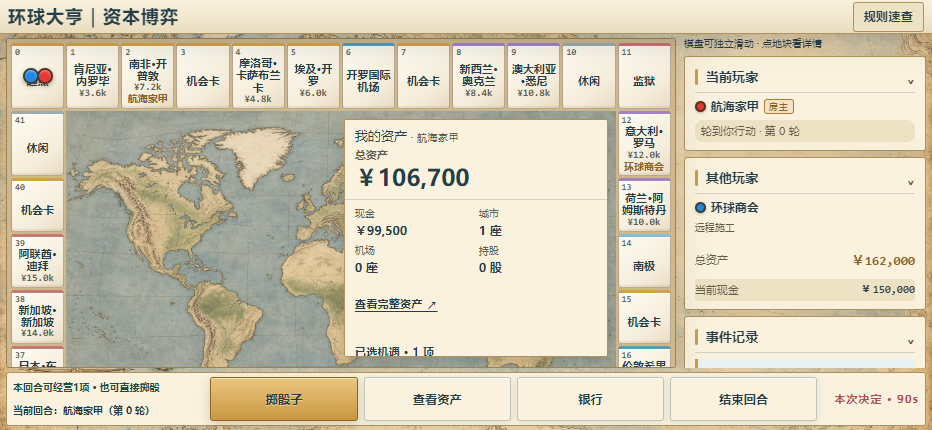

# 手机横屏 Atlas 验收

日期：2026-10-12。按用户参考截图与统一授权，先独立完成Spec/Plan/Tasks/Checklist并自审，再实施。

## 实现

横屏恢复左侧12×11环形42格、中央完整地图与单一资产模块、右侧本人/其他玩家/事件、全宽底栏。主动作、资产、银行、结束回合及个人时钟单排独立布局；经营入口继续位于资产模块。风格、素材、费用和Socket沿用。

竖屏仍6×7，PC/正常平板沿原布局。横屏最小地块44px，不隐藏名称、价格、归属、房级、抵押；窄/低高度在棋盘内部滚动，右侧及资产内部可滚动。图片contain不拉伸，低高度通过滚动看完整内矩形。未承诺所有42格完整文字与全部信息一屏可见。

## 实际验收

| 清单 | 实际结果 |
|---|---|
| C1 | 通过：普通/快速×844×390、932×430、568×320、844×280，左棋盘/右侧栏/全宽底栏，无整页横向溢出；单位验证42格唯一且环形邻接 |
| C2 | 通过：所有地块名称显示、最小44px，长昵称/房4/抵押状态保留，首末及四角实点打开原详情；568px真实CDP触摸滑动证明scrollLeft增加 |
| C3 | 通过：读取四角几何，中央地图及资产完全位于内矩形，background-size=contain；资产入口实点打开真实资产 |
| C4 | 通过：四个底栏按钮至少44px高，个人时钟可见，银行直接触控；右侧其他玩家及事件独立滚动阅读；滑动短提示位于右侧顶部释放棋盘空间 |
| C5 | 通过：竖→横→竖保留股票草稿/状态/截止；四玩家及动画旋转真实格位回归；PC/平板、真实200%缩放、键盘/减少动画、原购地/机场/建房募资、赎回和缓存升级通过 |

布局单位2/2。浏览器17个不同测试组分批复验通过：初次综合批次16/17，低高度棋盘137px未达到140px门槛；将短提示移到右侧释放棋盘空间后，最终布局及原移动5/5通过。其余12组资金、响应式/缩放与缓存已经通过，未重复计入。lint退出0。没有批量完整对局。

证据：[单位](../../artifacts/mobile-landscape-atlas-unit.txt)、[初次综合回归及高度失败](../../artifacts/mobile-landscape-atlas-browser.txt)、[最终布局/触摸/旋转复验](../../artifacts/mobile-landscape-atlas-targeted.txt)、[lint](../../artifacts/mobile-landscape-atlas-lint.txt)、[几何记录](../../artifacts/mobile-landscape-atlas/measurements.json)。

## 预览

受控截图含普通/快速各四种横屏，见artifacts/mobile-landscape-atlas/。主题和信息来源为实际前端，预览数据为受控状态，不代表线上正在进行的对局。

## 命令与交付

    node --test --test-force-exit test/board-layout.test.js
    node --test --test-force-exit --test-concurrency=2 e2e/mobile-landscape-atlas.spec.js e2e/mobile-playability.spec.js e2e/responsive.spec.js e2e/mortgage-redemption.spec.js e2e/purchase-fundraising.spec.js e2e/build-fundraising-stock.spec.js e2e/cache.spec.js
    node --test --test-force-exit --test-concurrency=2 e2e/mobile-landscape-atlas.spec.js e2e/mobile-playability.spec.js
    node node_modules/eslint/bin/eslint.js public/client.js public/board-layout.js test/board-layout.test.js e2e/mobile-landscape-atlas.spec.js e2e/mobile-playability.spec.js e2e/responsive.spec.js e2e/cache.spec.js

开发验收完成。本机Edge Chromium模拟触控视口及原生触摸事件；实体微信浏览器和Render公网未实测。资源20261012-landscape-atlas-v1、缓存global-tycoon-v23-landscape-atlas。未推送GitHub或部署Render，当前线上不会自动具有未推送的改版；缓存升级不强制刷新在玩对局。
